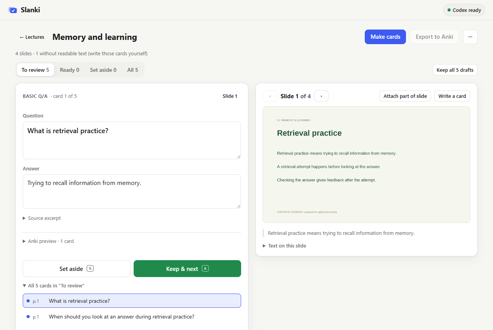
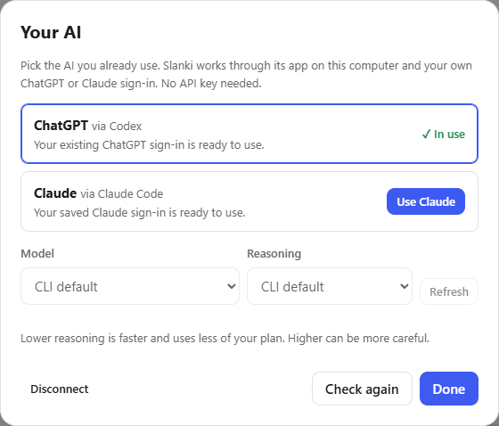
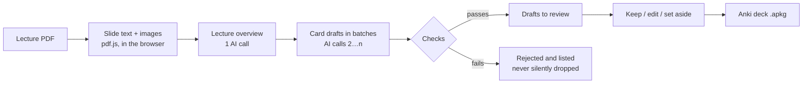

# Slanki

**Turn lecture slides into Anki flashcards with the AI you already use.**

Drop in a lecture PDF. Slanki has ChatGPT (through Codex) or Claude (through Claude Code) draft flashcards. You review each card next to the slide it came from, then export a deck that opens in Anki. Everything runs on your own computer.



## Download

**Windows:** download `Slanki.exe` from the [latest release](../../releases/latest) and double-click it. Slanki opens in your browser. There is no window to keep open: Slanki runs quietly in the background and closes itself a few minutes after you close its tab (it finishes any card run first). Double-click it again to come back.

You also need one of these AI apps, signed in with your normal account. Slanki shows an **Install** or **Sign in** button for each, so setup is a couple of clicks:

| Your subscription | App Slanki uses |
|---|---|
| ChatGPT | [Codex](https://developers.openai.com/codex/cli) |
| Claude | [Claude Code](https://code.claude.com/docs/en/setup) |

> Windows may warn that the app is from an unknown publisher, because it isn't code-signed. Choose **More info → Run anyway**.



## How to use it

1. **Drop a lecture PDF** (up to 100 slides).
2. **Make cards.** Choose the slides and roughly how many cards you want, and optionally add reverse cards. Slanki picks question/answer or cloze cards by itself.
3. **Review.** Each draft sits beside its slide. Use **Keep** (A), **Set aside** (S) and **Undo** (Z), edit in place, or write your own cards.
4. **Export to Anki.** You get an `.apkg` file. Exporting again later updates the same notes in Anki, so your review history is kept.
5. **Back up** one lecture or your whole library, and restore it on any computer.

No AI app? **Make cards → Use any chat** copies a ready-made prompt for ChatGPT, Claude or Gemini on the web. Paste the answer back and Slanki checks it the same way.

## How it works



The AI is treated as an **untrusted** source. Its output is useful, but it is never saved without checks:

- **Fixed format.** Every call must return JSON that matches a strict schema. Malformed answers are rejected.
- **Grounded in the slides.** Each card must quote its source slide word for word, and Slanki checks that the quote really appears on that page. Cards without real support never reach you.
- **Whole-lecture context.** A first call summarises the lecture's topics. Card batches then see the big picture, not just two slides. If that summary fails the checks, the AI gets the errors back and retries, up to 3 times.
- **Budgeted batching.** Long lectures are split into batches that share a card budget, duplicates and course logistics (exam dates, rooms) are filtered out, and a stopped run can be resumed where it left off.
- **Honest partial results.** Unreadable slides, rejected drafts and failed batches are shown. A half-finished run never looks finished.
- **Safe local bridge.** A web page can't start programs, so a small local server runs the AI app for it. That server only listens on `127.0.0.1`, only answers Slanki pages that have been paired with it, and passes slide text in a way the system shell never sees. It also limits time and output size, and never touches your AI login files.

**Private by design.** No accounts, servers or analytics. Lectures, cards and backups live in your browser's storage on your computer. Slide text goes only to the AI you picked, through your own account.

## Built with

TypeScript, Preact, Vite, pdf.js and sql.js (to write Anki's package format), plus Node.js for the local bridge and the Windows build. Tested with Vitest (267 unit tests) and Playwright browser tests in Chrome, Firefox and WebKit, run against a simulated AI.

## Build from source

Requires Node.js 24.

```
npm install
npm run build:exe                     # helper/dist/exe/Slanki.exe (Slanki for macOS/Linux when run there)
```

Or run without building an app: `npm run build`, then `node helper/dist/slanki.mjs --local`.

For development:

```
npm run dev                           # app on http://localhost:5173 (start the helper with --allow-origin http://localhost:5173)
npm test                              # unit tests
npm run serve                         # built app with production headers on :4173
node app/e2e/workflow.mjs             # browser test (SLANKI_BROWSER=firefox|webkit)
node app/e2e/generation.mjs           # browser + helper + simulated AI
node app/e2e/readme-shots.mjs         # refresh the screenshots above (after build:exe)
```

Slanki can also be hosted as a static website (see `vercel.json`), with users running the helper through `npx slanki`. More detail: [architecture and privacy](docs/ARCHITECTURE.md), [status](docs/STATUS.md).
